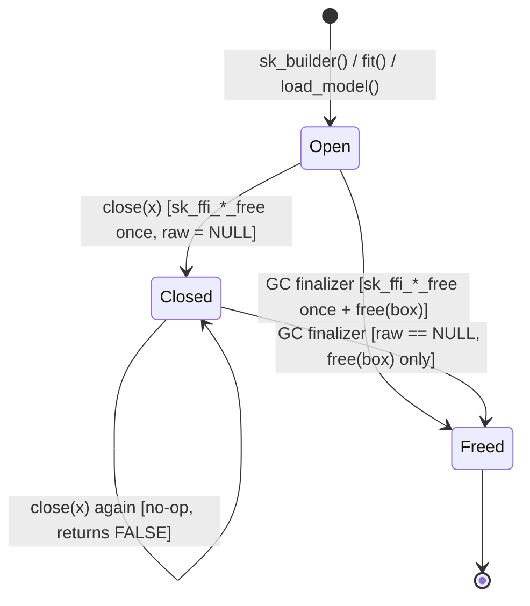

# Handle Lifecycle

R uses tracing garbage collection, whereas `sciencekit_ffi` owns opaque `SKFfiBuilder*` and `SKFfiModel*` handles allocated in Rust's handle registry. `sciencekitr` bridges both worlds so handles **never leak** and **never double-free**.

## Dual Release Paths, Single Idempotent Helper



Every `sciencekit_builder` and `sciencekit_model` stores an `EXTPTRSXP` pointing to a small heap-allocated `SKRHandleBox` (`{ kind, raw }`):

1. **Explicit `close(x)`:** frees `box->raw` immediately (`sk_ffi_builder_free` or `sk_ffi_model_free`), sets `box->raw = NULL`, and returns `TRUE` invisibly. Subsequent calls to `close(x)` see `box->raw == NULL` and return `FALSE` without calling into the ABI.
2. **Garbage-collector finalizer (`R_RegisterCFinalizerEx(..., onexit = TRUE)`):** runs when `x` becomes unreachable or when the R session exits. It calls the same `release_handle_box()` helper (freeing `box->raw` only if still non-`NULL`), frees `box` itself, and clears the external pointer.

## Operations on Closed Handles

Calling `fit()`, `predict()`, `transform()`, `score()`, `save_model()`, or builder setters on a closed handle raises `sciencekit_error` with `status = "invalid-handle"` (`1L`) before any pointer is passed to Rust (tested in `tests/testthat/test-errors-and-lifecycle.R`):

```r
library(sciencekitr)

x <- matrix(c(0.0, 1.0, 0.0, 2.0, 0.0, 0.0, 1.0, 3.0), nrow = 4, ncol = 2)
y <- c(1.0, 3.0, 4.0, 14.0)

builder <- sk_linear_regression()
model <- fit(builder, x, y)

close(model)   # returns TRUE invisibly
close(model)   # idempotent no-op, returns FALSE invisibly
is_closed(model)
#> [1] TRUE

tryCatch(
  predict(model, x),
  sciencekit_error_invalid_handle = function(err) {
    cat(err$status, err$status_code, "\n")
  }
)
#> invalid-handle 1

close(builder)
```

## Leak Verification Across Repeated Failures

`live_handle_counts()` exposes the C shim's active builder and model counters (`c(builders = ..., models = ...)`), allowing deterministic tests that neither garbage-collected scopes nor repeated failing operations leak handles:

```r
gc()
baseline <- live_handle_counts()

local({
  b <- sk_linear_regression()
  m <- fit(b, matrix(c(0.0, 1.0, 0.0, 2.0, 0.0, 0.0, 1.0, 3.0), nrow = 4), c(1.0, 3.0, 4.0, 14.0))
  predict(m, matrix(c(1.0, 2.0), nrow = 1))
})
gc()

identical(live_handle_counts(), baseline)
#> [1] TRUE
```
