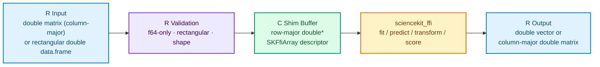

# Dense Matrices and Data Frames

`sciencekitr` enforces a single, predictable numeric contract at the R/C boundary: **rectangular dense `double` (`f64`) matrices and vectors**.

## Column-Major to Row-Major Transposition

R stores matrices in **column-major** order (`REAL(x)[row + col * nrow]`), whereas `sciencekit_ffi` (`SKFfiArray` with `strides = NULL`) expects **row-major** buffers (`data[row * ncol + col]`).



On input, `copy_r_matrix_to_row_major()` copies `REAL(x)` into a temporary row-major buffer for the duration of the ABI call and frees it immediately after the call returns. On `transform()`, the ABI's row-major output descriptor is transposed into a column-major R `REALSXP` matrix and freed immediately via `sk_ffi_array_free()`.

## Why `f64`-Only Semantics?

R's native numeric storage mode (`typeof(1.0) == "double"`) is IEEE-754 binary64 (`f64`); R has no built-in `f32` vector type. Rather than silently coercing `integer`, `logical`, `factor`, or `character` matrices (which can mask upstream data bugs), `sciencekitr` validates element types explicitly before crossing `.Call`:

From `tests/testthat/test-matrices-and-f64.R`:

```r
library(sciencekitr)

builder <- sk_linear_regression()

# Integer matrices are rejected rather than silently coerced:
int_mat <- matrix(1L:4L, nrow = 2, ncol = 2)
tryCatch(
  fit(builder, int_mat, c(1.0, 2.0)),
  sciencekit_error = function(e) e$native_message
)
#> [1] "only double (f64) matrices are supported; received 'integer' matrix"

# Convert explicitly in R when intended:
storage.mode(int_mat) <- "double"

# Requesting f32 on a builder is rejected with status "unsupported" (4L):
tryCatch(
  sk_builder("linear_regression", dtype = "f32"),
  sciencekit_error = function(e) c(e$status, e$status_code)
)
#> [1] "unsupported" "4"

close(builder)
```

## Ragged Input and Shape Validation

Malformed or ragged `data.frame` / column-list inputs and mismatched row counts between `x` and `y` raise a `sciencekit_error` with `status = "shape"` (`2L`) before calling into C:

```r
ragged_df <- structure(
  list(x1 = c(1.0, 2.0), x2 = c(1.0, 2.0, 3.0)),
  class = "data.frame",
  row.names = c(NA, -2L)
)

builder <- sk_standard_scaler()
tryCatch(
  fit(builder, ragged_df),
  sciencekit_error = function(e) c(e$status, e$status_code)
)
#> [1] "shape" "2"
close(builder)
```
