# sciencekit for R (`sciencekitr`)

`sciencekitr` brings the [`sciencekit`](https://github.com/neurono-ml/sciencekit) Rust machine-learning engine to R through a minimal, safety-first `.Call` C shim over the stable `sciencekit_ffi` C ABI.

Instead of reimplementing numerical solvers in R or relying on unregistered `dyn.load()` symbol lookups, `sciencekitr` links the same Rust implementation used by the Go and Lua bindings while behaving like an ordinary R package: S3 builders and models, `stats::predict()` and `base::transform()` generics, structured `sciencekit_error` conditions, and automatic garbage-collector finalizers paired with idempotent `close()` methods.

## Architecture at a Glance

```mermaid
flowchart LR
    accTitle: sciencekitr boundary architecture
    accDescr: Data flow from R matrices and S3 objects through registered .Call entry points into the C shim and static libsciencekit_ffi.a
    R["R User Code<br/>matrix / data.frame · S3 generics"]:::sky -->|"useDynLib(.registration = TRUE)"| CALL["Registered .Call Layer<br/>src/init.c · R_registerRoutines"]:::violet
    CALL -->|"column-major ↔ row-major<br/>SKRHandleBox external ptrs"| SHIM["C Shim<br/>src/sciencekitr.c"]:::emerald
    SHIM -->|"sciencekit.h C ABI"| FFI["sciencekit_ffi (Rust)<br/>libsciencekit_ffi.a"]:::amber

    classDef sky fill:#e0f2fe,stroke:#0284c7,color:#0c4a6e,stroke-width:2px;
    classDef violet fill:#ede9fe,stroke:#7c3aed,color:#3b0764,stroke-width:2px;
    classDef emerald fill:#dcfce7,stroke:#059669,color:#14532d,stroke-width:2px;
    classDef amber fill:#fef3c7,stroke:#d97706,color:#78350f,stroke-width:2px;
```

## Design Pillars

- **Registered `.Call` routines only:** `R_init_sciencekitr()` registers every native routine via `R_registerRoutines()`, disables dynamic symbol lookup (`R_useDynamicSymbols(dll, FALSE)`), and enforces symbol objects (`R_forceSymbols(dll, TRUE)`).
- **Deterministic + GC-safe handle lifecycles:** builders (`sciencekit_builder`) and fitted models (`sciencekit_model`) wrap R external pointers with C finalizers (`R_RegisterCFinalizerEx`) and eager, idempotent `close()` S3 methods. Calling an operation on a closed handle raises a structured `invalid-handle` error instead of touching freed memory.
- **Strict `f64`-only (`double`) numeric contract:** R `double` matrices and rectangular `double` data frames are validated and transposed cleanly between R's column-major layout and the C ABI's row-major layout. Integer, logical, character, ragged, and `f32` inputs are rejected explicitly rather than silently coerced.
- **Structured R conditions:** ABI and validation errors raise S3 conditions inheriting from `sciencekit_error`, carrying `status`, `status_code`, `operation`, and `native_message`.

## Supported Capabilities

| Capability | R Entry Points | Notes |
|---|---|---|
| ABI introspection | `abi_version()`, `abi_features()` | Reports ABI `1.0.0` and feature bitmask |
| Ordinary least squares | `sk_linear_regression()`, `fit()`, `predict()`, `score()` | Configurable `include_intercept` and math `backend` |
| Standard scaling | `sk_standard_scaler()`, `fit()`, `transform()`, `sk_transform()` | Configurable `with_mean`, `with_std`, and math `backend` |
| Model persistence | `save_model()`, `load_model()` | Supported for fitted `f64` linear-regression models |
| Lifecycle control | `close()`, `is_closed()`, `live_handle_counts()` | Idempotent release + GC finalizer safety |
